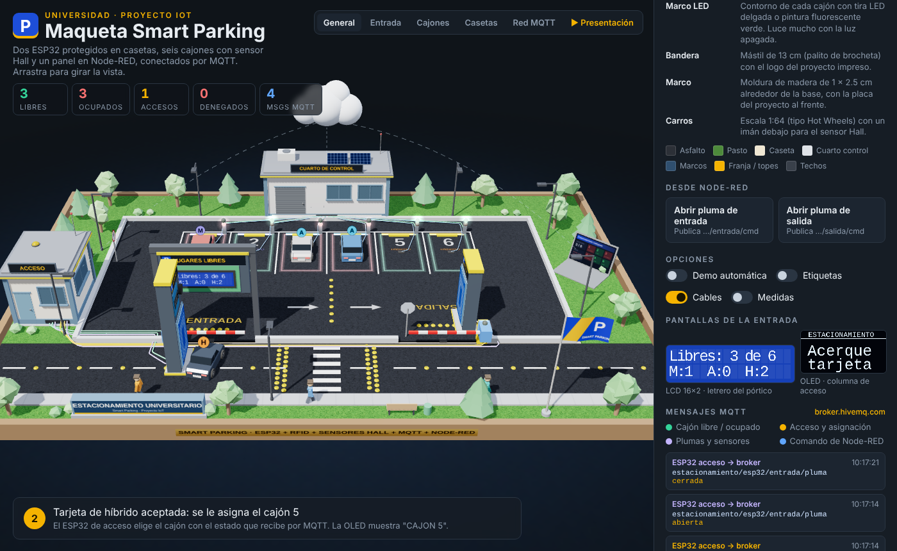
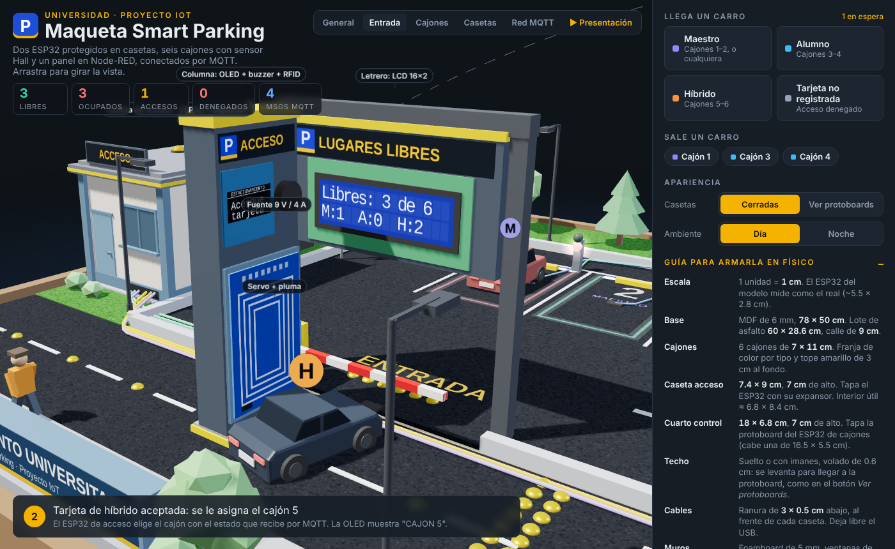
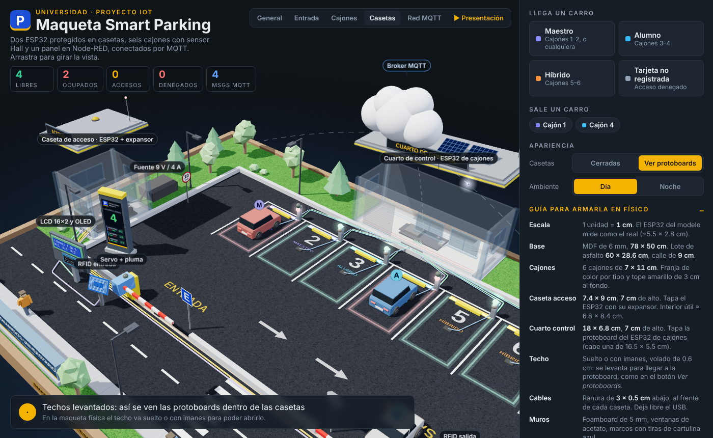
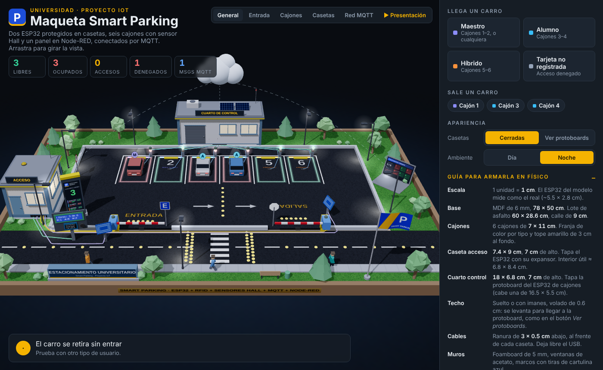

# Maqueta Smart Parking

Maqueta 3D interactiva de un estacionamiento inteligente universitario. Sirve como simulación del sistema y como plano para construir la maqueta física.

**Ver en línea:** https://gabrielyiyi.github.io/Maqueta_SmartParking/

## Qué simula

- **Dos ESP32** comunicados por **MQTT** (`broker.hivemq.com`):
  - **ESP32 de acceso:** lectores RFID de entrada y salida, plumas con servo, sensores Hall bajo las plumas, LCD 16×2, OLED y buzzer.
  - **ESP32 de cajones:** 6 cajones con sensor Hall y LEDs verde/rojo.
- **Node-RED** como panel de monitoreo y para abrir las plumas a distancia.
- **Tipos de usuario por tarjeta:** Maestro (cajones 1–2, o cualquiera si están llenos), Alumno (3–4) e Híbrido (5–6). Una tarjeta no registrada recibe acceso denegado.

Cada mensaje MQTT aparece en el panel con su tópico y su contenido, y se ve viajar por la red en la escena.

## Cómo usarla

Abre `index.html` en el navegador; no necesita instalar nada.

- **Llega un carro / Sale un carro:** lanza el flujo completo (lectura RFID, asignación de cajón, pluma, sensor Hall, MQTT).
- **Casetas → Ver protoboards:** levanta los techos para ver la electrónica.
- **Ambiente → Noche:** enciende postes, ventanas, boyas y LEDs.
- **▶ Presentación:** oculta el panel, gira la cámara y recorre las vistas sola. Ideal para exposiciones. Sal con el botón o con Esc.
- **Medidas:** muestra las cotas para construirla.

## Entrada (de afuera hacia adentro)

1. **Pórtico con el LCD 16×2:** muestra los lugares libres por tipo, visible desde la calle.
2. **Columna de acceso del lado del conductor:** OLED (cajón asignado), buzzer y lector RC522.
3. **Pluma** con servo y sensor Hall.

En la salida hay una columna solo con el RC522.

## Casetas

La **caseta de acceso** tapa el ESP32 de acceso y su expansor. El **cuarto de control** tapa la protoboard del ESP32 de cajones. Los techos van sueltos o con imanes para poder abrirlos.

## Planos para construirla

**[Planos_SmartParking.pdf](planos/Planos_SmartParking.pdf)** (8 hojas, tamaño Carta): plano general 1:4, coordenadas de cada sensor, corte del sensor Hall, plantillas 1:1 de cajón, entrada y salida, frentes de las columnas y casetas. Imprime al 100 % y comprueba la barra de 10 cm.

### Sensores Hall

- **Cajones:** al centro del cajón, a 3.8 cm del tope (Y = 15.8 cm desde el fondo de la base).
- **Plumas:** 5 cm después del brazo, al centro del carril.
- **Imán en cada carro:** neodimio Ø 10 × 1–2 mm, a 3.8 cm de la defensa delantera, polo sur hacia abajo.

## Medidas (1 unidad = 1 cm)

| Pieza | Medida |
|---|---|
| Base | MDF 6 mm, 78 × 50 cm |
| Lote / calle | 60 × 28.6 cm / 9 cm de ancho |
| Cajones | 6 de 7 × 11 cm |
| Caseta de acceso | 7.4 × 9 cm, 7 cm de alto |
| Cuarto de control | 18 × 6.8 cm, 7 cm de alto (cabe una protoboard de 16.5 × 5.5 cm) |
| Pórtico del LCD | 11.4 cm entre postes × 12.8 cm de alto, caja de 10.2 × 5.4 × 2.5 cm |
| Columna de acceso | 5.2 × 3 × 12 cm (OLED 0.96" + buzzer + RC522 vertical + servo) |
| Columna de salida | 5.2 × 3 × 8.6 cm (RC522 + servo) |
| Plumas | 7.4 cm (entrada), 7.8 cm (salida) |
| Postes de luz | 9 cm |
| Boyas | Ø 0.6 cm |
| Carros | Escala 1:64 (tipo Hot Wheels) con un imán debajo |

Materiales sugeridos: foamboard de 5 mm para las casetas, acetato para ventanas, pasto sintético o fieltro, esponja verde para árboles y medias perlas pintadas de amarillo para las boyas. Pasa los cables por perforaciones debajo de la base.

## Tecnología

Una sola página HTML con [three.js](https://threejs.org/) r128 cargado desde CDN.
